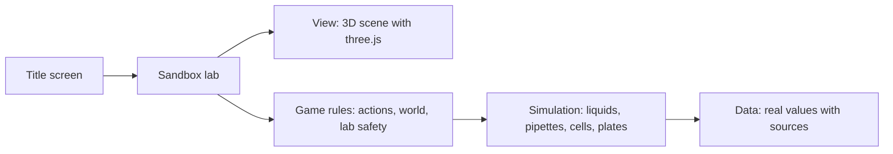

<!-- Alex 202384014054 -->

# Capstone Project: Wet Lab Sandbox

**Student:** Alex (Student ID: 202384014054)<br>
**Status:** Week 3 — the sandbox runs on its own

## Project Idea

A browser game that lets anyone walk into a virtual biology lab and use
real lab equipment: a biosafety cabinet, pipettes, a centrifuge, a
microscope, an incubator and a plate reader. There are no goals and no
score. You can try the things a real cell culture lab does, and the
equipment behaves the way the real equipment does.

My long-term goal is a game that is good enough to publish on a public
platform. For this course I am building it step by step and adding
visible changes every week.

## Where It Came From

This project is based on a personal project I started on Nov 1, 2026: a
lab game built around cancer drug research. For this course I copied it
and turned it into a separate, simpler sandbox. The original game is not
part of this repository and I am not changing it.

In Week 2 I worked on a different idea, a Course Task Tracker. Those files
are still in `python/` and `html/` as my Week 2 record.

## How I Use AI

I use AI coding tools in this project, and I want to be clear about who
does what:

* I decide the direction and the rules of the game.
* I play-test it and say what needs to change.
* I check the lab steps and equipment against real sources.
* I wrote or changed some of the code myself.
* Most of the code was written by AI coding tools, following my
  instructions.

## How to Run It

The game needs a small local web server (the browser will not load the
modules from a plain file).

```bash
cd wet-lab
python3 -m http.server 8670
```

Then open `http://localhost:8670` in Chrome. A keyboard and a mouse or
trackpad are needed. Press **F** for full screen.

To run the automated tests (Node.js 18 or newer):

```bash
cd wet-lab
npm test
```

## How the Game Is Built



* `wet-lab/src/view/` and `wet-lab/src/view3d/` draw the lab.
* `wet-lab/src/game/` holds what the player can do and the state of the lab.
* `wet-lab/src/sim/` simulates liquids, pipettes, cell growth and the plate reader.
* `wet-lab/src/data/` holds real values (for example cell doubling times), each with its source.
* `wet-lab/vendor/three/` is the three.js library (MIT License), not my code.

## Stations in the Sandbox

| Key | Station | What is there |
|---|---|---|
| 1 | Biosafety cabinet | pipettes, tips, tubes, plates, aspirator |
| 2 | Bench | balance, microscope, water bath, vortex mixer, centrifuge |
| 3 | Incubator | two flasks of A549 cells |
| 4 | Fridge | culture medium, PBS, trypsin, CCK-8 |
| 5 | Plate reader | plate reader and a computer for the data |

## Roadmap

1. **Separate the sandbox** from the original game (Week 3, done).
2. **Make it look real:** lighting and materials, the main instruments,
   close-up shots during experiments, and what you see under the
   microscope. Add an English/Chinese language switch.
3. **Add more content:** more instruments, consumables, reagents and cell types.
4. **Add new ways to play**, such as a lab manual with guided experiments.

## Progress Log

* **Nov 4, 2026 (Week 2):** Set up the project folder and wrote a README in
  class. Wrote a first Python version of a Course Task Tracker.
* **Nov 5, 2026 (Week 3):** Switched my project to the Wet Lab Sandbox.
  Copied my earlier lab game and removed everything about cancer and
  drugs: the patient cases, CT scans, gene sequencing, the automated
  workstation and all levels. The game now opens straight into the free
  lab, with A549 cells in the incubator. Fixed a bug where the close
  button of the in-game computer showed an "×" and an "Esc" label on top
  of each other. Added my name and student ID to every file I own.
  All 54 tests pass.

## Next Steps

* Rework the lighting and the materials (glass, metal, plastic, liquids).
* Add the English/Chinese language switch, starting with the title screen and menus.
* Replace the hover box around objects, which is too loud and not precise enough.

## Open Questions

* What should the game be called when it is published?
* Which instruments should be made realistic first?
