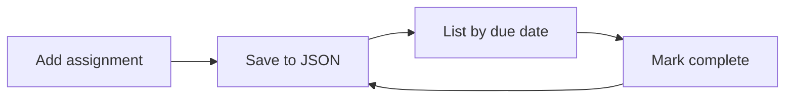

<!-- Alex 202384014054 -->

# Capstone Project: Course Task Tracker

**Student:** Alex<br>
**Status:** Planning

## Project Idea

Assignments and due dates are often spread across course websites, emails,
and notes. I want to build a small tool that keeps them in one place and
shows what is due next.

## Planned Features

* Add an assignment with a course name, a title, and a due date.
* List unfinished assignments, sorted by due date, and mark overdue ones.
* Mark an assignment as complete.
* Save everything in a local JSON file so the list is still there next time.

## Tools

* **Python** for the program itself
* **JSON** for saving the data
* **VS Code** for writing and running the code
* **Markdown** for this README and my progress notes

---

## How It Should Work



## What I Store for Each Assignment

* **course**: the course name
* **title**: what the assignment is
* **due**: the due date, written as YYYY-MM-DD so it sorts correctly
* **done**: True or False

## First Version (python/Alex.py)

The first version uses a few sample assignments. It lists the unfinished
ones by due date, marks overdue work, marks one assignment as complete,
and prints how many are done. One assignment looks like this:

```python
{"course": "Math", "title": "Homework 3", "due": "2026-11-06", "done": False}
```

It does not save anything yet. That is the next step.

## Completion Rate

$$
\text{Completion rate} = \frac{\text{Completed assignments}}{\text{Total assignments}} \times 100\%
$$

## HTML in Markdown

Markdown can also take HTML. Inside a code block it shows as plain code:

```html
Hello<br>World
```

Outside a code block it is rendered, so the line breaks:<br>
Hello<br>World

## Progress Log

* **Nov 4, 2026:** Set up the project folder and wrote this README in class.
* **Nov 4, 2026:** Decided what to store for each assignment. Wrote a first
  Python version that sorts sample assignments by due date and marks one complete.

## Next Steps

* Save the assignments to a JSON file and load them when the program starts.
* Let the user type in a new assignment instead of using sample data.
* Add a simple menu: add, list, complete, quit.

## Open Questions

* Should completed assignments still show in the list, or only in the summary?
* Is a command-line program enough, or should it become a web page later?
