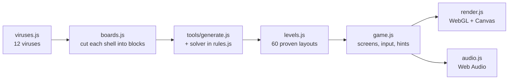

<!-- Alex 202384014054 -->

# Capstone Project: Capsid Lockdown

**Student:** Alex (Student ID: 202384014054)<br>
**Project:** [`capsid-lockdown/`](capsid-lockdown/), version v0.1<br>
**AI use:** I used Claude Code (Claude Fable 5.2 and Claude Opus 5.5). Details in [AI_USE.md](AI_USE.md).

## Project Idea

Capsid Lockdown is a puzzle game in the browser: Minesweeper played on the
outer shell (the capsid) of a virus. There are twelve real kinds of virus,
from norovirus to herpes simplex virus, and each shell is made of 32 to 144
protein blocks. A few blocks are resistant to the drug; those are the mines.
The player locks the normal proteins, reads the numbers and flags the
resistant ones.

Every level can be solved by logic alone. A solver in the code proves this
for each layout, and the hints use the same solver to explain each step.

There is also an experimental real-time mode, "Hold the Cell Cluster",
where the player is the immune system and defends 32 cells against three
waves of norovirus.

Full rules, controls and file list: [capsid-lockdown/README.md](capsid-lockdown/README.md).

## How to Run It

**Play online** (nothing to download):
<https://zyun20041026.github.io/Senior-Capstone-Project/Alex-202384014054/capsid-lockdown/>

**After downloading:** on the GitHub page of the repository, click
**Code → Download ZIP** and unzip it. Open the folder
`Alex-202384014054/capsid-lockdown/` and double-click `index.html`. Nothing
needs to be installed.

**With the local server** (needs Node.js 22 or newer). From the top folder
of the repository, run:

```bash
node Alex-202384014054/capsid-lockdown/tools/serve.js
```

Then open <http://127.0.0.1:8765/> in Chrome. Stop it with `Ctrl + C`.

**Tests** (also need Node.js). From the top folder of the repository, run:

```bash
node --test Alex-202384014054/capsid-lockdown/tests/*.test.js
```

Chrome is recommended. The game starts in English; the **中文** button
switches to Chinese. More detail, such as using another port:
[capsid-lockdown/README.md](capsid-lockdown/README.md#how-to-run-it).

## What Is in This Folder

| Folder or file | What it is |
| --- | --- |
| `capsid-lockdown/` | my course project (start from `capsid-lockdown/index.html`, see above) |
| `AI_USE.md` | which AI tools and models I used, and for what |
| `python/task_tracker.py` | Week 2 practice: a small Course Task Tracker in Python, v0.1 |
| `html/Alex.html` | Week 2 practice: a short page about me and my project |

## How the Game Is Built



## Progress Log

* **Nov 4, 2026 (Week 2):** Set up the project folder and wrote a README in
  class. Wrote a first Python version of a Course Task Tracker.
* **Nov 5, 2026 (Week 3):** Switched my project to a Wet Lab Sandbox, a
  3D lab game copied from an earlier personal project, with the cancer and
  drug content removed. Added my name and student ID to every file I own.
* **Nov 10, 2026 (Week 4):** Small cleanup of text left over from the
  cancer-drug game in the wet lab sandbox.
* **Nov 17, 2026:** Switched my course project from the wet lab sandbox to
  Capsid Lockdown, a puzzle game I made earlier with AI: Minesweeper played
  on the shells of twelve real kinds of virus. The wet lab sandbox is gone
  from the folder but is still in the Git history.

  The teacher reviewed my repository in class and pointed out several
  problems. What I changed for each one:
  - **AI use was not stated clearly.** Wrote `AI_USE.md`. It names the tool
    (Claude Code) and the models (Claude Fable 5.2 and Claude Opus 5.5),
    what each one did, and what I did myself. Commits made with AI end with
    a `Co-Authored-By: Claude` line.
  - **No "how to run" instructions in the project folder.** The wet lab
    folder had no README of its own. `capsid-lockdown/README.md` now
    explains how to start the game (`node tools/serve.js`), how to play, the
    controls, the twelve viruses, the files and how to run the tests.
  - **File names should say what the program is.** Renamed
    `python/Alex.py` to `python/task_tracker.py`. The game folder is named
    `capsid-lockdown`, after the game.
  - **No version number.** Marked the game and the task tracker as v0.1.
  - **Credit for other people's work.** Added `CREDITS.md`: the Minesweeper
    rules, the visual style taken from a video on Anthropic's Claude
    YouTube channel (no images from the video are in the repository), and
    the textbook shapes of the viruses. No third-party code, images or
    sounds are used.
  - **Name and student ID in every file.** Added `Alex 202384014054` as a
    comment at the top of every code, style, test and tool file, including
    the file that the level generator writes.

  The teacher reads English, but the game was only in Chinese, so I also
  added an English / Chinese switch. The game starts in English; the
  **中文** button (or `?lang=zh` in the address) switches to Chinese, and
  the choice is saved. All screens, hints, the tutorial, the virus dossiers
  and the duel mode have English text.

  Checked: all 52 automated tests pass (6 of them are new, for the language
  switch), every one of the 60 levels can still be solved by logic alone,
  and I went through the main game and the duel mode in the browser in both
  languages. Known issue: in English on a small phone screen, the bottom
  button bar is wider than the screen and scrolls sideways.
* **Nov 24, 2026:** Made the game easier to start for someone who gets it
  from GitHub:
  - The game is now online with GitHub Pages:
    <https://zyun20041026.github.io/Senior-Capstone-Project/Alex-202384014054/capsid-lockdown/>
  - Both README files now explain three ways to start it: the online link,
    Download ZIP and double-click `index.html` (no install), and the local
    server. The server and test commands now work from the top folder of
    the repository, so there is no `cd` step to get wrong.
  - `tools/serve.js` now prints the address to open and how to stop it,
    says what to do when port 8765 is already in use, and accepts another
    port number (`node tools/serve.js 9000`). It also no longer crashes on a
    broken address, and it only serves files inside the game folder.
