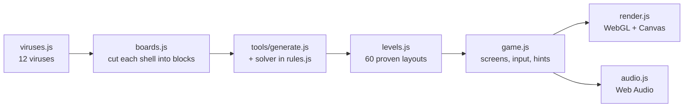

<!-- Alex 202384014054 -->

# Capstone Project: Capsid Lockdown

**Student:** Alex (Student ID: 202384014054)<br>
**Project:** [`capsid-lockdown/`](capsid-lockdown/), version v0.1<br>
**AI use:** I used Claude Code (Claude Fable 5.2 and Claude Opus 5.5). Details in [AI_USE.md](AI_USE.md).

## Project Idea

Capsid Lockdown is a puzzle game in the browser: Minesweeper played on the
outer shell (the capsid) of a virus. There are twelve real kinds of virus,
from norovirus to herpes simplex virus, and each shell is made of 32 to 144
protein blocks. A few blocks are resistant to the drug; those are the mines.
The player locks the normal proteins, reads the numbers and flags the
resistant ones.

Every level can be solved by logic alone. A solver in the code proves this
for each layout, and the hints use the same solver to explain each step.

There is also an experimental real-time mode, "Hold the Cell Cluster",
where the player is the immune system and defends 32 cells against three
waves of norovirus.

Full rules, controls and file list: [capsid-lockdown/README.md](capsid-lockdown/README.md).

## How to Run It

You need Node.js 22 or newer and Chrome.

```bash
cd capsid-lockdown
node tools/serve.js
```

Then open <http://127.0.0.1:8765/> in Chrome. The game starts in English;
the **中文** button switches to Chinese.

To run the tests:

```bash
cd capsid-lockdown
node --test tests/*.test.js
```

## What Is in This Folder

| Folder or file | What it is |
| --- | --- |
| `capsid-lockdown/` | my course project (start from `capsid-lockdown/index.html`, see above) |
| `AI_USE.md` | which AI tools and models I used, and for what |
| `python/task_tracker.py` | Week 2 practice: a small Course Task Tracker in Python, v0.1 |
| `html/Alex.html` | Week 2 practice: a short page about me and my project |

## How the Game Is Built



## Progress Log

* **Nov 4, 2026 (Week 2):** Set up the project folder and wrote a README in
  class. Wrote a first Python version of a Course Task Tracker.
* **Nov 5, 2026 (Week 3):** Switched my project to a Wet Lab Sandbox, a
  3D lab game copied from an earlier personal project, with the cancer and
  drug content removed. Added my name and student ID to every file I own.
* **Nov 10, 2026 (Week 4):** Small cleanup of text left over from the
  cancer-drug game in the wet lab sandbox.
* **Nov 17, 2026:** Switched my project to Capsid Lockdown and removed the
  wet lab sandbox (it is still in the Git history). Changes based on the
  teacher's feedback in class:
  - Renamed `python/Alex.py` to `python/task_tracker.py`, so the file is
    named after the program, and marked it v0.1.
  - Wrote `AI_USE.md`, which names the AI tools and models I used and what
    they did.
  - Put a README with "How to Run It" inside the project folder itself.
  - Added an English / Chinese switch. The game starts in English.
  - Added `CREDITS.md` for the ideas I borrowed.
  - Added my name and student ID to every file.
